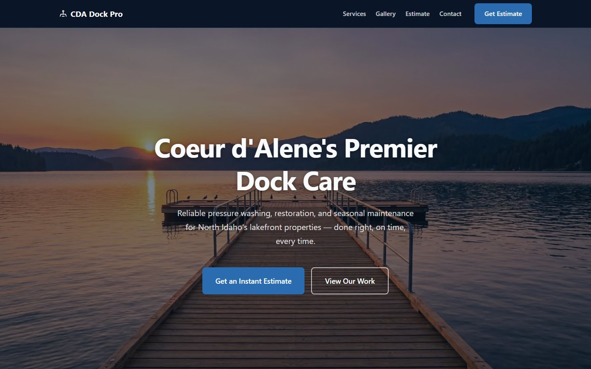
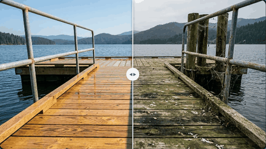
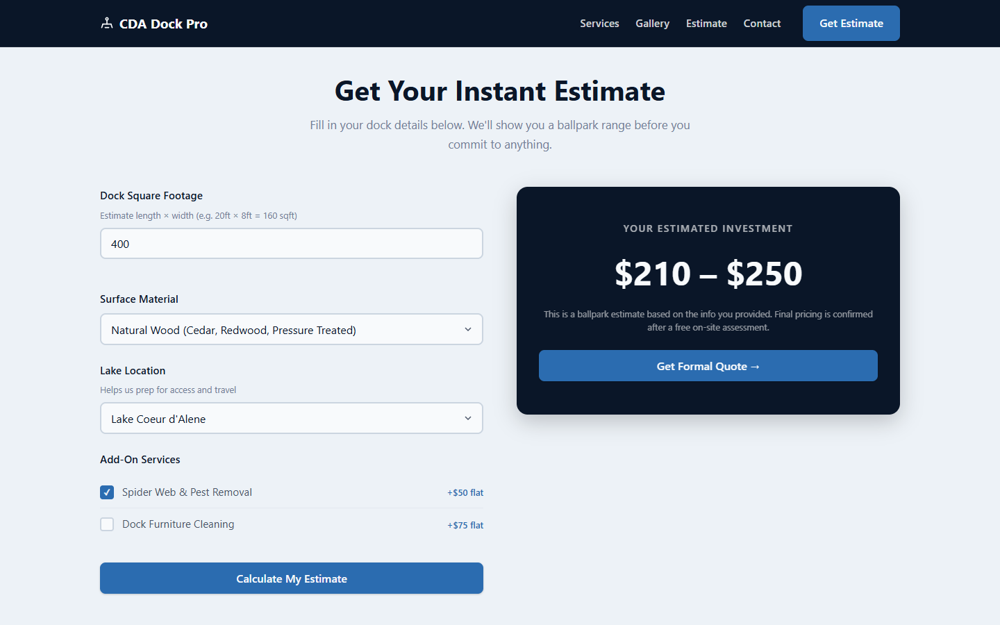
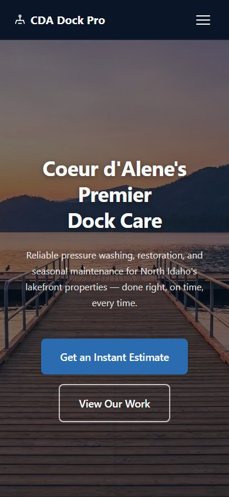
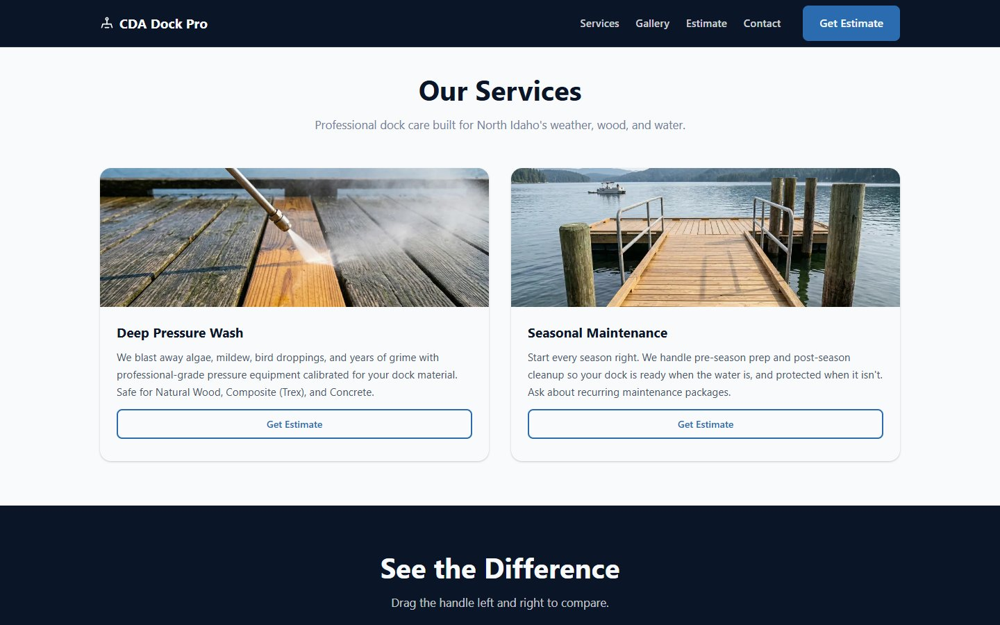
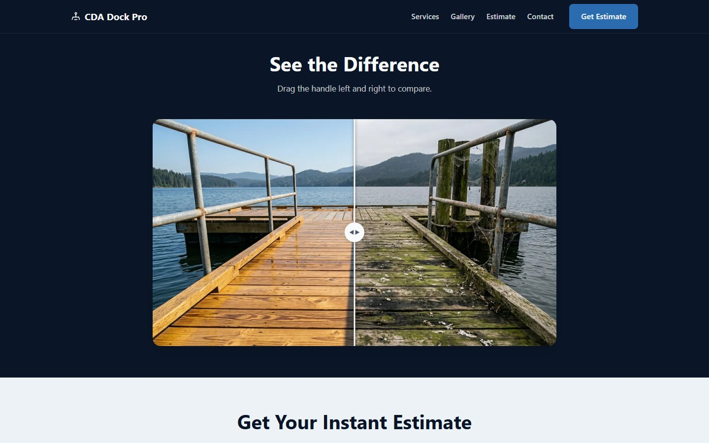

# CDA Dock Pro

**Live site: [cdadockpro.com](https://www.cdadockpro.com)**

I started CDA Dock Pro, a dock pressure-washing business serving lakefront homes around Coeur d'Alene, Idaho, and built this website so customers could find the business, see what a cleaning would cost, and get in touch. Homeowners get an instant price estimate and can request a formal quote, and every lead lands in my inbox and an Airtable CRM automatically.



> **Note:** the forms on the live site are connected to my real business. Feel free to try the estimate calculator, but please don't submit test quote requests.

## Features

- **Instant estimate calculator.** Prices by square footage, surface material and add-ons, with a minimum job price and a low–high range. All rates live in one `PRICING_CONFIG` object, so pricing changes need no logic edits.
- **Serverless lead pipeline.** Quote and contact forms post to Vercel functions that email a formatted lead summary (via Resend) and save the lead to Airtable.
- **Before/after comparison slider.** Built from scratch with Pointer Events (mouse + touch), plus full keyboard support (arrows, Home/End) and ARIA slider semantics.
- **Spam and abuse protection.** Server-side validation (email format, per-field length limits), a honeypot field to filter bots, and HTML-escaping of all user input before it goes into the notification email.
- **Responsive and accessible.** Mobile navigation, a native `<dialog>` quote modal, labelled form controls, screen-reader text and visible focus states.
- **Local SEO.** Keyword-targeted title and meta tags, Open Graph tags, canonical URL and semantic, single-H1 page structure.
- **Fast.** No framework and no build step. Photos are served as resized WebP (about 660 KB total, down from 33 MB of source PNGs).

<p align="center">
  
</p>

## Screenshots

| Instant estimate | Mobile |
|---|---|
|  |  |

| Services | Before/after gallery |
|---|---|
|  |  |

## Tech stack

| Layer | Choice |
|---|---|
| Front end | Semantic HTML, modern CSS (custom properties, grid, flexbox), vanilla JavaScript |
| Back end | Vercel serverless functions (Node.js) |
| Email | [Resend](https://resend.com) API |
| Lead storage | [Airtable](https://airtable.com) API |
| Hosting | Vercel |

## How a lead flows

```
Visitor fills out quote / contact form
        │  fetch POST (JSON)
        ▼
/api/leads  or  /api/contact      (Vercel function)
        │  1. honeypot check → silently drop bots
        │  2. validate fields → 400 on bad input
        │  3. escape input, build HTML email
        ├──────────────► Resend  → lead email to the owner (reply-to = customer)
        └──────────────► Airtable → row in the "Leads" table
```

The email is sent first. If the Airtable write fails, the error is logged and the visitor still sees a success message, so a CRM outage never loses a lead the owner was already emailed about.

## Project structure

```
index.html            Single-page site
styles/dock-pro.css   All styles (design tokens at the top)
js/dock-pro.js        Calculator, slider, modal, forms, nav, scroll effects
api/leads.js          Quote-request endpoint
api/contact.js        Contact-form endpoint
api/_utils.js         Shared validation, escaping and honeypot helpers
images/               Optimized WebP photos
```

## Running locally

```bash
npm i -g vercel
cp .env.example .env.local   # then fill in your keys
vercel dev                   # serves the site and /api functions at localhost:3000
```

The static site alone can be previewed with any file server (for example `python -m http.server`), but the forms need `vercel dev` to reach the API.

| Variable | Required | Purpose |
|---|---|---|
| `RESEND_API_KEY` | Yes | Sends lead notification emails |
| `AIRTABLE_API_KEY` | No | Saves leads to Airtable |
| `AIRTABLE_BASE_ID` | No | The Airtable base containing a `Leads` table |

## What I learned

- **Building for my own business.** I was both the developer and the customer. The pricing, service areas and copy came from actually running the business, and I tuned the estimate ranges to what dock cleaning costs on the local lakes, so the calculator gives customers numbers I'd really quote.
- **Treating user input as untrusted.** My first version put form values straight into the email HTML. Adding escaping, validation and a honeypot showed me how a public form can be abused, even on a small site.
- **Performance is mostly assets.** My original photos were about 33 MB. Resizing them and converting to WebP cut that by about 98%, a bigger win than any code change.
- **Never losing a lead.** The lead email is sent before the Airtable save, so if Airtable goes down I still hear about every customer who reached out.
